# Claude Parallel Accounts

[](#requirements)
[](LICENSE)

**A companion for the [Claude Code extension for VS Code](https://marketplace.visualstudio.com/items?itemName=anthropic.claude-code): a different Claude account in each VS Code window, at the same time, with one shared conversation history — and, per window, a choice of who serves and bills the requests, plus other models the window's AI can hand work to.**

Claude Code signs you into **one** account, shared by every window. This extension gives **each window its own account** (personal, work, a second plan for when the first hits its limits), keeps your conversations in one history across all of them, and lets each window bill to its Anthropic login, an Anthropic API key, or a gateway such as Z.ai. The window's Claude can also consult or delegate real work to other models you enable — GLM on Z.ai, or Claude on your own subscription — and you review what they change before it lands.

It's a **companion**, not a replacement: the official Claude Code extension must be installed.

> **About this fork.** This is [warrenb213/claude-parallel-profiles](https://github.com/warrenb213/claude-parallel-profiles), a fork of [DercasDrol/claude-parallel-profiles](https://github.com/DercasDrol/claude-parallel-profiles). Upstream (1.3.x, on the Marketplace) provides the per-window accounts and shared history. This fork adds [providers](#providers), [workers](#workers) and [agent tasks](#agent-tasks-real-work-reviewed-by-the-lead), and is installed from a `.vsix` — it is never published to the Marketplace. See [Install](#install).

> **Linux only (for now).** Desktop Linux, **WSL**, **Remote-SSH** to a Linux host, and dev containers. The check happens where the extension runs — in a WSL or SSH window that's the Linux *remote* — so a Windows or macOS desktop driving a Linux remote is fully supported. On macOS and native Windows the extension stays completely **inert**: no files read or written, no accounts touched; the status bar says why. (Claude Code stores credentials differently there, e.g. in the macOS Keychain, and guessing would be worse than declining.)

---

## Contents

- [The idea in 30 seconds](#the-idea-in-30-seconds) · [Architecture](#architecture) · [Requirements](#requirements) · [Install](#install)
- [Accounts](#accounts) · [One conversation history](#one-conversation-history)
- [Providers](#providers) · [Workers](#workers) · [Seeing what workers did](#seeing-what-workers-did)
- [Commands](#commands) · [Privacy & your data](#privacy--your-data) · [Uninstalling](#uninstalling) · [Limitations](#limitations)
- [How it works](#how-it-works) · [Development & releases](#development--releases)

---

## The idea in 30 seconds

- **Sign in as usual**, through Claude Code's own account menu or `/login`. The extension notices and saves the account by itself; the account *is* its email.
- **Each window picks its account** from the status bar. Two windows run two accounts at once — no logout/login dance. The window's integrated terminals get the same account.
- **Switching reloads the window.** Claude Code reads its account once at start-up, so only a reload makes it both *show* and *bill* the account you picked.
- **History stays one whole.** Hit a usage limit, switch account, continue the same conversation.
- **Each window picks its provider too:** the account's Anthropic login (the default), an Anthropic API key, or a gateway such as Z.ai's GLM Coding Plan.
- **Workers:** the window's Claude can ask other models you enabled for answers, or have them do real work in a scratch copy of your repo, which it reviews before applying.
- **Forget really signs out**, and **uninstalling really cleans up**: your history goes back into the default `~/.claude`, your last account stays signed in there.

---

## Architecture

Every VS Code window runs its own extension host, so its environment is its own. This extension activates first and points that window's Claude Code at a private data directory (`CLAUDE_CONFIG_DIR`), which holds the window's account and provider settings. Everything else hangs off that.

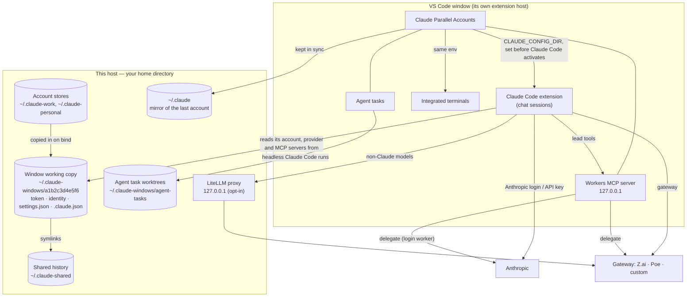

| Part | Source | What it does |
| --- | --- | --- |
| Accounts | `accounts.ts`, `capture.ts`, `setupWizard.ts`, `reclaim.ts` | Discover, save, switch, forget and sign out accounts. |
| Window binding | `binding.ts`, `workdir.ts`, `accountWatcher.ts` | The window's working copy, its environment variable, and noticing sign-ins. |
| Shared history | `sharedHistory.ts` | One history store, linked from every data directory. |
| Status bar | `statusBar.ts` | The account item: its text, click action and hover card. |
| Providers | `providers.ts`, `modelCatalog.ts`, `litellm.ts`, `litellm/` | Per-window billing, gateway model lists, the optional LiteLLM proxy. |
| Workers | `delegate.ts`, `usage.ts` | The MCP server the lead uses: `delegate`, usage, agent task tools. |
| Agent tasks | `agentTasks.ts`, `transcripts.ts` | Snapshots, worktrees, headless runs, diffs, transcripts. |
| Host state | `hostState.ts` | `~/.claude-windows/.state.json`, shared by every window on the host. |
| Uninstall | `uninstall.js` | Hands back the account and history and removes the extension's folders. |

---

## Requirements

| Requirement | Notes |
| --- | --- |
| Linux environment | desktop Linux, WSL, Remote-SSH (Linux host), or a dev container |
| VS Code ≥ 1.85 | the extension installs into the (remote) Linux side |
| [Claude Code extension](https://marketplace.visualstudio.com/items?itemName=anthropic.claude-code) | the thing being multiplied |
| `claude` CLI on `$PATH` | asked read-only (`claude auth status`) whether a directory is signed in |
| `git` | agent tasks only: they work on a worktree of the window's repository |
| `uv`, or Python 3.10–3.14 | non-Claude models only: installs the local LiteLLM proxy |

---

## Install

1. **Get the `.vsix`.** Build it (`npm ci && npm run package`, see [Development](#development--releases)), or use one you were given — `claude-parallel-accounts-<version>.vsix`.
2. **Install it** where the extension runs: in the window itself (a WSL or SSH window installs on the remote), *Extensions → ⋯ → Install from VSIX…*, or `code --install-extension claude-parallel-accounts-<version>.vsix`. Reload the window.
3. **You're probably already signed in.** The status bar shows your email; the account is saved automatically.
4. **Add another account:** in Claude Code, sign in as it (account menu, or `/login`). The extension saves it and reloads the window onto it; the previous account stays in the list.
5. **Give each window its account:** status bar → *Switch account*. Another window, another account — both run in parallel.

The fork keeps upstream's extension ID (`DercasDrol.claude-parallel-accounts`), so it replaces an upstream install. The Marketplace's upstream version (1.3.x) is lower, so VS Code won't swap it back; if upstream ever publishes a higher one, turn off *Auto Update* for this extension.

---

## Accounts

**The status bar item** — `👤 you@example.com` is the account **this window** runs as, confirmed against the real token (`claude auth status`), not just a label. A provider other than Anthropic is named after it (`· Z.ai`), and active agent tasks are counted (`· ⟳ 2`).

- **Click** it for the one action that fits: switching when you have other accounts, picking one when the window is signed out, saving when this is your only account and it isn't saved yet.
- **Hover** it for the full card: the account and plan, the provider, workers and recent agent tasks, actions (*Save*, *Switch account*, *Switch provider*, *Agent tasks*, *Usage*, *Forget…*), and links to the extension page and its log.

**Switching** (*Switch account*) reloads the window; afterwards both the identity Claude Code shows and the token it bills are the ones you picked.

**Signing in as another account inside a window** (Claude Code's account menu, or `/login`) replaces only *that window's* account. The extension saves the new account, keeps the old one, and reloads the window so Claude Code actually switches; other windows are untouched.

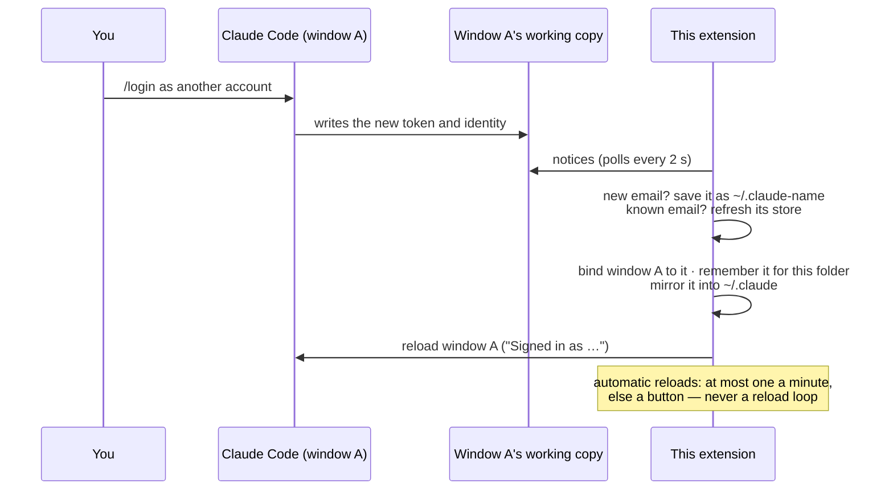

**Reopening a project** restores the account that folder used last (the tooltip says so).

**One account, one entry.** Saving the same email twice reuses the entry; lists show one row per account.

**Forgetting** (hover → *Forget…*) asks first, then:

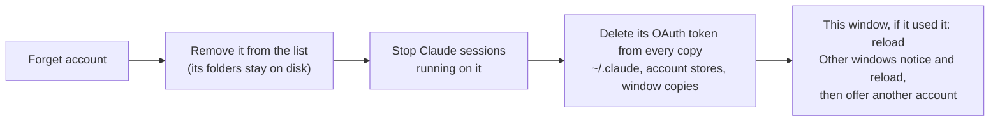

History, settings and the folders stay; signing in again brings the account back.

**Signing out** (Claude Code's account menu, or `/logout`) revokes the token on Anthropic's side. The window shows *Claude: sign in* at once; the next time the window starts, the extension removes the account from the list and deletes the token's other copies, since switching to it could only fail.

---

## One conversation history

Claude Code keeps its history per *data directory*, and plain Claude Code has only one. This extension gives each window a directory of its own, so it puts the history back together in one store, `~/.claude-shared`, linked from every directory:

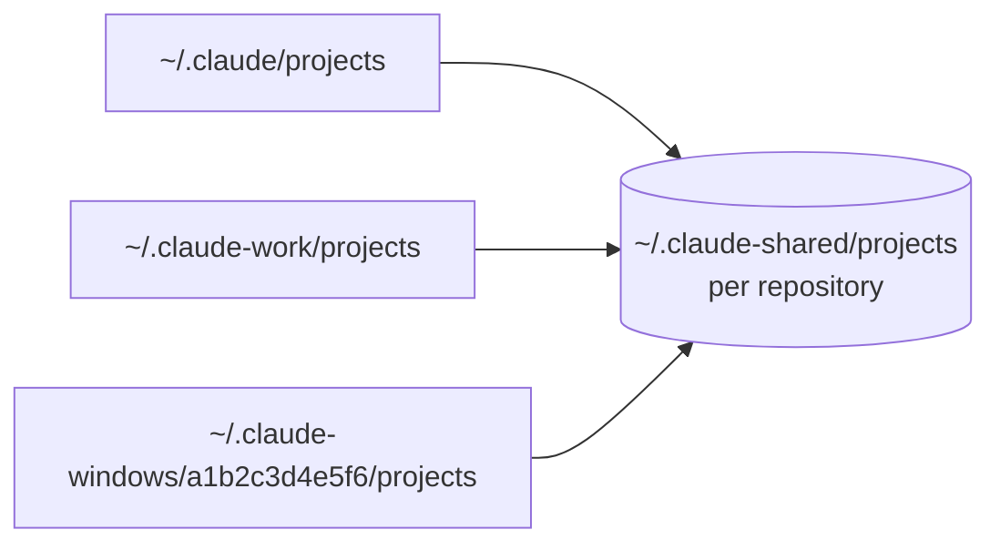

- Linked: `projects`, `sessions`, `session-env`, `shell-snapshots`, `file-history`, `plans`, `todos` and `history.jsonl`. **Credentials and identity never are** — those stay strictly per account.
- Existing history is merged in when a directory is first linked: identical files once, otherwise the newer wins and the older is kept in `~/.claude-shared/.merge-backup`; `history.jsonl` lines are combined.
- Transcripts stay keyed by workspace folder, exactly as Claude Code writes them.

There is nothing to configure: this is what keeps Claude Code's own behaviour intact. Uninstalling moves the store back into `~/.claude`.

---

## Providers

A window's **provider** decides where its requests go and who pays, without changing the account: same history, settings and project trust.

| Kind | What it is | How requests travel |
| --- | --- | --- |
| **Anthropic** (default) | The account's own login: a claude.ai plan (Pro, Max, Team, Enterprise) or a Console key from `/login`. The menu shows which, e.g. *Team plan · Acme*. | Claude Code → Anthropic, as without this extension. |
| **Anthropic API key** | A key from [console.anthropic.com](https://console.anthropic.com), billed per token, without signing the account in with it. | Claude Code → `api.anthropic.com` with that key. The extension pre-approves the key, so Claude Code's "Detected a custom API key" prompt (whose default, *No*, would silently fall back to the login) never appears. |
| **Gateway** | An Anthropic-compatible endpoint with a key. Presets: **Z.ai GLM Coding Plan** and **Poe**; **Custom** for anything else (`Authorization: Bearer` or `x-api-key`). | Claude Code → the gateway. Non-Claude models on gateways that only speak OpenAI's format go through a local LiteLLM proxy. |

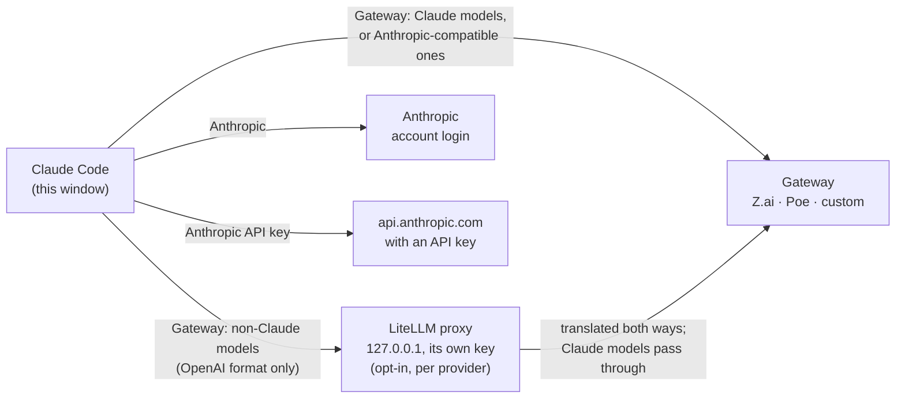

**Switching** (hover → *Switch provider*, or *Claude Accounts: Switch Provider for This Window*) writes the provider's settings into the window's own `settings.json` and reloads the window; terminals follow it. **To go back to Anthropic from anything else, pick *Anthropic*** — the settings the provider took over are restored as they were.

**Adding** (*Claude Accounts: Add a Provider*) lists the presets first, so a preset asks only for a key. A new provider is tested right away with one tiny request, sent the way Claude Code sends it, so a wrong key or an empty balance shows up then rather than mid-chat; it's then offered for this window. *Edit or Remove a Provider* replaces a key, renames or removes a provider, runs the test again, and for gateways changes the URL, the default models, beta headers, non-Claude models and workers.

**Providers belong to one account on one host.** A provider is seen only by windows running that same Claude account on that same host; the same account on another host adds its own.

### Models on a gateway

- **Z.ai GLM Coding Plan** is set up as [Z.ai documents for Claude Code](https://docs.z.ai/devpack/tool/claude): GLM in the opus/sonnet/haiku slots (`glm-5.3[1m]`, `glm-5.3-flash[1m]`) with its 1M context window and a long request timeout. Change the slots under *Model aliases*.
- **Gateways with a model list** (Poe, most custom ones): `/v1/models` is read when you add it, daily while a window uses it, and on *Refresh model list*. Only the Claude models it serves are kept, and Claude Code's model picker lists exactly those, each recognised as the model it is (thinking, effort levels, context window) and sent under the gateway's name for it (Poe's `claude-opus-4.8` is Anthropic's `claude-opus-4-8`). A model the gateway doesn't serve falls back to an allowed one instead of failing.
- **Auto mode on gateways.** A gateway can't run Anthropic's in-request safety checks, so the extension says so up front (`CLAUDE_CODE_AUTO_MODE_SERVER=0`): auto mode then runs its classifier as separate requests on the gateway, without first holding a request behind an "isn't eligible" notice.

### Non-Claude models (opt-in, per provider)

Many gateways also serve models such as Qwen, GLM or DeepSeek, but only in OpenAI's chat-completions format, which Claude Code doesn't speak. *Edit or Remove a Provider → Non-Claude models* lists the usable ones (text output, tool calling, at least a 200K context window — what Claude Code assumes for a model it doesn't know) and adds the ones you pick to the model picker. The first one asks to install a local [LiteLLM](https://github.com/BerriAI/litellm) proxy (about 600 MB, into `~/.claude-windows/litellm`):

- **Pinned by hash.** LiteLLM's PyPI package was hijacked in March 2026, and this proxy holds your gateway key, so it is never installed by name: every package is pinned by SHA-256 in the extension's lockfile and installed with `--require-hashes`.
- **Local only.** One proxy per provider per host, on `127.0.0.1`, behind a random key of its own. Windows hold only that key; the gateway key lives in the proxy's environment, never in a file. LiteLLM's start-up downloads of remote configuration are off.
- **Fixed for Claude Code.** A small callback rewrites tool schemas gateways reject (`prefixItems`) and holds back a gateway's early `finish_reason`, which otherwise cut off parallel tool calls.
- **Shared and stopped cleanly.** Windows on the same provider share the proxy; a window on an older extension version reuses a newer one's rather than fighting over it. Turning the models off, removing the provider, or uninstalling stops it. *Show proxy log* opens its log.

Claude Code is built for Claude; other models can use its tools, but less reliably.

---

## Workers

The window's Claude (the **lead**) can hand work to other models you've set up — Claude on your subscription leads and asks, say, GLM on Z.ai for a second opinion, a review or a whole change. Workers are off until you pick them, per provider (*Edit or Remove a Provider → Workers*), with a one-time confirmation of what leaves the machine. Claude on the account's own login can be a worker too (*Anthropic login (this account)*: haiku, sonnet, opus).

| | `delegate` (answers) | Agent tasks (real work) |
| --- | --- | --- |
| Opt-in | per worker model | a second opt-in per worker model |
| The worker gets | the task and what the lead pastes in | a scratch copy of the repo, file tools and a shell |
| What comes back | an answer | a report and a diff, applied only by the lead |
| The lead's tools | `list_workers`, `delegate`, `provider_usage` | `start_task`, `wait_task`, `cancel_task`, `apply_task_changes` |

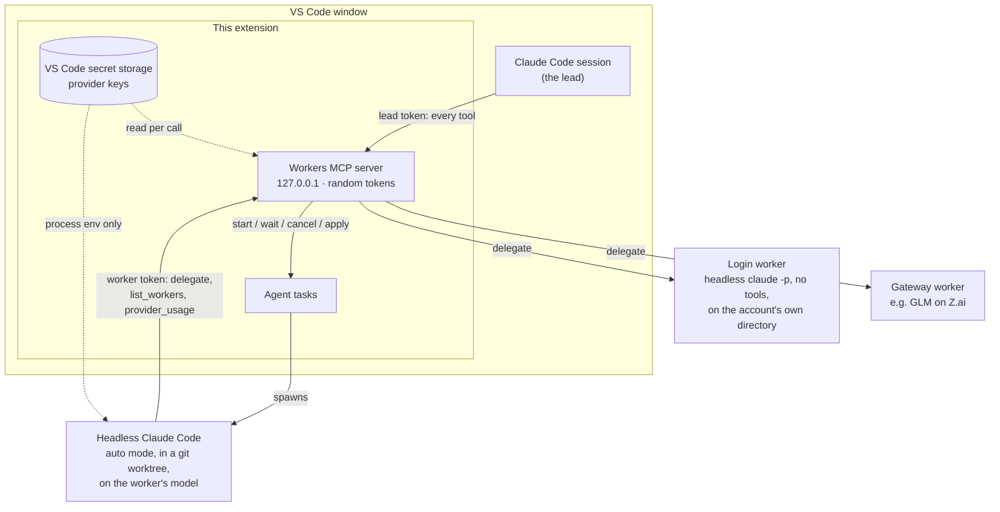

**How it's served.** A small MCP server inside the extension, on `127.0.0.1`, registered in the window's own Claude Code config (`.claude.json`) while some worker is enabled, and removed when none is or the window closes. Open sessions are told when workers change (`tools/list_changed`) and pick up the new tools without restarting. Each call reads the provider's key from VS Code's secret storage; the window's own provider is untouched.

### `delegate`: answers only

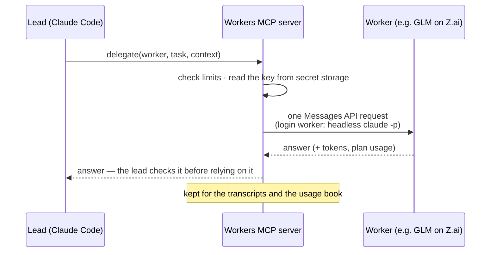

- The worker gets the task and what the lead pastes in — nothing else. It can't read files, run commands or change anything.
- At most 120,000 characters sent and 8,192 tokens back per call, and 100 calls per window session. GLM gets extra room for its thinking, and is asked again without thinking if that used the whole budget.
- **Login workers** run Claude Code itself, headless, on the account's own directory (never a window's working copy, which may be set to a gateway), with no tools, no MCP servers and the session not saved. The extension never handles the subscription's token. Calls count toward the plan.

### Agent tasks: real work, reviewed by the lead

A worker enabled for agent tasks runs **Claude Code headless on its own model** (e.g. GLM-5.3 on Z.ai), in **auto mode**, inside a scratch **git worktree** of your repo. It edits files and runs builds and tests there; nothing reaches your working tree unless the lead reviews the diff and applies it.

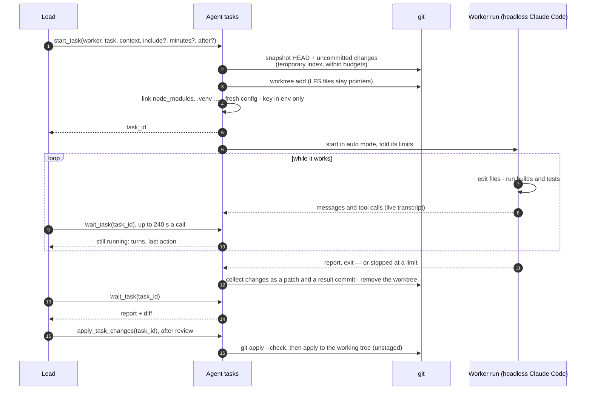

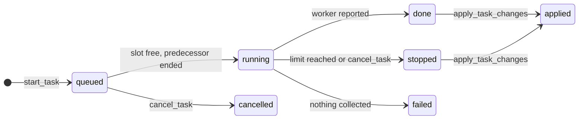

*Stopped* shows as `failed` or `cancelled` with its changes kept. A done or stopped task can also be continued: `start_task(after: id)` queues a new task that starts from its changes.

- **The snapshot.** HEAD plus your uncommitted changes, built with a temporary index so yours is never touched. Untracked files come along within a budget — 5 MB a file, 100 MB and 2,000 files in all, `.gitignore` respected — by top-level folder, smallest first; a folder that doesn't fit is left out whole. Git LFS files are never copied (they stay pointers). A repository whose tracked files exceed 5 GB is refused. What was left out is told to the worker and the lead.
- **Gitignored files it needs.** The lead lists them in `include` (files or folders; 5 MB a file, 100 MB and 2,000 files in all), or names a file in the task by absolute path. Paths to your repo in the task are rewritten to the worker's copy.
- **Builds and tests.** Gitignored dependency folders at the top of the repo (`node_modules`, `.venv`, `venv`, `vendor`, …) are linked into the worktree. They're your copies, so the worker is told not to install into them, and the links are removed before its changes are collected.
- **Isolation.** A fresh Claude Code config: none of your login, plugins or MCP servers; the provider key only in the run's environment. It runs the Claude Code extension's own binary — the version your chats use — and `claude` on PATH only where that extension isn't installed. A run that doesn't start in auto mode (an older Claude Code may quietly fall back to "default", where every edit is denied) is stopped at once with that reason.
- **Safety checks.** Auto mode checks each consequential action with a classifier on the worker's own model (about 35K tokens a check on Z.ai).
- **What comes back.** The report and a diff against the snapshot: changes to existing files, and new files the worker wrote with its file tools. Files that only appeared as side effects of its commands (build output, caches, logs) are listed but left out. The patch and run log stay under `~/.claude-windows/agent-tasks` for 7 days.
- **Applying.** `apply_task_changes` checks the patch first and applies it to the working tree only — never staged — with your usual Claude Code permission for that tool.
- **Limits.** 2 tasks at a time. Each gets 2 hours and 300 turns unless the lead sets `minutes` (5–480) or `max_turns` (10–1000); a run with no output for 20 minutes is taken as stuck. The worker is told its limits so it can stop in time to report.
- **Stopped runs keep their work.** A run stopped at a limit or cancelled keeps the changes it made: the lead can apply them, or continue with `start_task(after: id)` — the follow-up starts from them and is told where the run stopped, with its last message.
- **Chains.** `after` also builds pipelines: a task starts from another's result (waiting for it if it's still running), so fix → test → docs can be queued at once. Applying the last task of a chain applies the earlier, not yet applied ones too; nothing lands half-done.
- **Workers can consult.** A run can call `delegate` itself — GLM asking Claude on your subscription for a second opinion mid-task, say — plus `list_workers` and `provider_usage`. It can't start tasks: runs reach the workers server with a token limited to those three tools.

### Seeing what workers did

The account's hover card lists the workers and the recent tasks: worker, progress and current action while running; files changed and whether applied when done; why it stopped.

- **Transcripts.** A task's worker name in the hover opens that task's transcript; a worker under *Workers* (with a count) lists its tasks and consultations in this window. Transcripts open in the Markdown preview. A task's shows its run — messages, each tool call with its command or edit, results and thinking collapsed, the report and changes — and follows along while it runs; a consultation's shows the question, context and answer. Also *Claude Accounts: Show Worker Transcripts*. Consultations are kept in memory only, the latest 50.
- **Usage.** `provider_usage` (for the lead and for runs) and *Claude Accounts: Show Provider Usage* report how much of each plan is used, so work can be spread across subscriptions instead of exhausting one: the Anthropic login's 5-hour and weekly windows (from Claude Code's own rate-limit reports on login-worker calls), Z.ai's Coding Plan windows (from its quota monitor — unofficial, may change), and this window's calls, tasks and tokens per worker.

---

## Commands

All under **Claude Accounts** in the Command Palette; most are also in the status bar hover.

| Command | What it does |
| --- | --- |
| Switch Account for This Window | Pick a saved account; reloads the window. |
| Save Current Account | Save the account this window is signed in as (usually automatic). |
| Account Quick Action | The status bar click. |
| Forget a Saved Account | Remove an account and delete its token everywhere on this host. |
| Switch Provider for This Window | Anthropic, an API key, or a gateway; reloads the window. |
| Add a Provider | Presets (Z.ai, Poe), an Anthropic API key, or a custom gateway. |
| Edit or Remove a Provider | Key, URL, models, connection test, non-Claude models, workers. |
| Show Agent Tasks | Open a task's transcript, log or patch, or cancel it. |
| Show Worker Transcripts | A worker's tasks and consultations in this window. |
| Show Provider Usage | How much of each plan is used. |
| Show Log | What the extension has been doing. |

**Settings: none.** Everything is managed from the status bar and these commands.

---

## Privacy & your data

This extension manages credentials, so it holds itself to a strict policy — each point verifiable in the source.

- **No telemetry, no analytics, no runtime dependencies** — your files, the `vscode` API and Node's standard library.
- **Network requests, all to services you set up:**
  - a gateway's model list (`GET /v1/models`), when added, daily while in use, and on *Refresh*;
  - a provider's connection test: one tiny request when it's added and on *Test connection*;
  - worker calls (`delegate`), to the worker's provider, with what the lead sends;
  - Z.ai's quota monitor, for usage reports (a plain GET with the Z.ai key);
  - with non-Claude models on, the hash-pinned LiteLLM install from PyPI, and the proxy's traffic to your gateway;
  - Claude Code runs it starts (login workers, agent tasks) talk to their provider like any Claude Code session.

  With no providers or workers added, it makes no requests at all.
- **Everything stays in your home directory.** Accounts, working copies, the history store and host state live under `~/.claude*`, created owner-only (`700`/`600`). Credentials are only ever *copied between* Claude Code's own data directories on this host — never parsed beyond checking they exist, never displayed, never sent anywhere.
- **Provider keys** are kept in VS Code's secret storage on the computer running VS Code, under a name tied to the account and host. A window using a provider also gets a copy in its own `settings.json` (`600`), because that file is how Claude Code receives it; switching back to Anthropic, removing the provider, or uninstalling removes it. With non-Claude models on, the window gets the local proxy's key instead.
- **Workers send what the lead chooses, to the provider you enabled** — and, for a gateway such as Z.ai, to the model's maker — billed to its key. Nothing is sent unless the AI calls the tool, and only to models you switched on.
- **Agent tasks read your repo.** A worker enabled for agent tasks reads a scratch copy of the repository as it works, so that content goes to its provider. Its run has no access to your login, plugins or MCP servers, and its changes stay in the copy unless the lead applies them.
- **History is moved, not read.** It is relinked, never parsed or sent; when two directories hold the same file it's compared byte for byte, and `history.jsonl` lines are merged.
- **Host state** (`~/.claude-windows/.state.json`) records your accounts, providers (without keys), and which account each folder used last — by the folder's path. Window working copies are named by a hash of the workspace path.
- **Elsewhere:** `claude auth status` is asked locally, read-only; the process list is scanned only during *Forget*, to stop `claude` processes on the token being deleted.
- **Restricted by its manifest:** disabled in virtual workspaces, and in Restricted Mode (untrusted folders) it never reads workspace content ([`capabilities`](package.json)).
- **Inert off Linux** — no operations at all; the uninstall hook is guarded the same way.

---

## Uninstalling

Removing the extension leaves Claude Code **signed in and working**, with your whole history.

**You stay signed in the whole time, not just at the end.** While the extension runs, it keeps Claude Code's default `~/.claude` signed in as the account you last used. So the instant the extension is gone — uninstalled, disabled, or not activated yet — plain Claude Code works. Nothing that matters waits on the uninstall script, which VS Code defers to its next restart and may skip.

When the uninstall script runs, it has a 4-second deadline (VS Code kills it at 5):

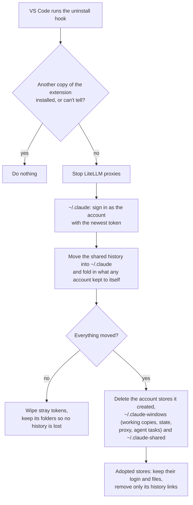

- Moving the history is a rename — instant, whatever its size.
- Your other accounts are signed out afterwards: plain Claude Code holds one account at a time.
- **Which account stores are deleted:** only the ones the extension created (they carry a `.claude-parallel-accounts` marker). A signed-in `~/.claude-<name>` folder that was already there when the extension found it is adopted as an account but stays yours: uninstall keeps it with its login and files, and only removes the history links it added — that history is in `~/.claude` now. (Stores saved before 1.14.2 were sorted once on upgrade: one named after its account's email, the way the extension names them, counts as created.)

---

## Limitations

- **Linux only for now.** macOS keeps credentials in the Keychain and native Windows is untested; on both the extension refuses to run rather than guess.
- **Loads at every VS Code start-up** (`*` activation) — required to win the race against Claude Code (see [How it works](#how-it-works)). The bundle is about 130 KB with no dependencies.
- **Switching reloads the window**, account or provider: Claude Code reads both once at start-up.
- **The same project in two windows shares one conversation list.** A folder and a `.code-workspace` containing it are two windows on one project; both see the same chats and could resume the same one under different accounts. The transcript is a tree, so this forks the conversation rather than corrupting it — but the two branches bill two accounts. Don't drive one chat from two windows at once.
- **Sign-out is tidied up at the next start.** After `/logout` the window shows *Claude: sign in* at once, but the account leaves the list when the window next starts.
- **Agent tasks need a git repository** with at least one commit, and `git` on the host.
- **Other models in Claude Code** use its tools less reliably than Claude, and auto mode's safety checks run on them too.
- **Unofficial usage data.** Z.ai's quota monitor isn't a documented API.

---

## How it works

Claude Code resolves its data directory from the `CLAUDE_CONFIG_DIR` environment variable, and every VS Code window runs its own extension host, so `process.env` is per window — that's the isolation. Each **account** is a store (`~/.claude-<name>`); each **window** runs on a private working copy of the account it picked.

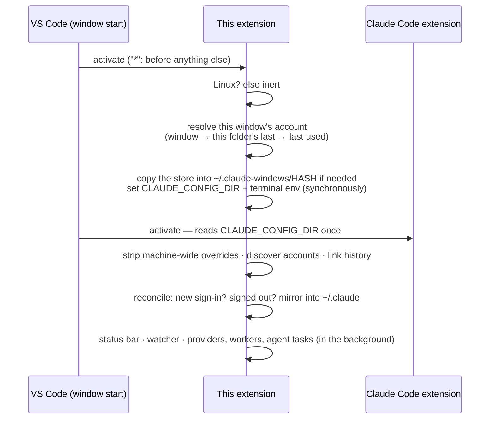

The details that make it reliable — each one a bug found and fixed:

- **Activation order.** Claude Code reads `CLAUDE_CONFIG_DIR` the moment it activates and caches it, so this extension must get there first. It uses the `*` activation event, which VS Code's docs discourage because it loads at every start-up: a deliberate trade-off, since with any lazier activation the variable would be set after Claude Code read it. The variable is set synchronously before anything else; account discovery and history linking follow, and providers and workers start in the background.
- **A working copy per window** (`~/.claude-windows/<12 hex>`, from a hash of the workspace). A `/login` writes into the window's own copy, so it can only affect that window — "which window signed in?" is answered by construction.
- **No competing source of truth.** A machine-wide `CLAUDE_CONFIG_DIR` in `claudeCode.environmentVariables` or `terminal.integrated.env` would force every window onto one account; the extension removes it and keeps isolation in `process.env` only.
- **Terminals follow the window** through VS Code's environment-variable API. External terminals keep the default `~/.claude`.
- **Provider settings live in the working copy.** A provider is written into the window's own `settings.json` (environment and model settings Claude Code reads at start), and only the keys the extension manages; everything else in that file is left alone. Workers are registered in the window's own `.claude.json`.
- **Host-wide state, per-host keys.** Accounts, providers and folder memories are in `~/.claude-windows/.state.json`, shared by every window on the host; VS Code's own storage is shared across hosts by the client, so only secrets live there, under host-specific names.
- **Reload safety.** Automatic reloads go through a circuit breaker: state is corrected *before* reloading, and at most one automatic reload a minute — an edge case degrades to a message with a button, never a reload loop.
- **Survives its own absence.** The account you last used is mirrored into `~/.claude` on every sync, so Claude Code works the instant the extension is gone.
- **Found where it runs.** One universal package, not per-platform: in WSL and Remote-SSH it runs on the Linux remote, but the client that resolves extensions is often Windows or macOS. The Linux requirement is enforced at runtime instead (the inert mode above).

---

## Development & releases

```bash
npm ci            # install
npm run watch     # dev build with watch
npm run compile   # typecheck + build
npm run package   # build the .vsix (production bundle)
```

**Releases of this fork** are `.vsix` files built with `npm run package` and installed by hand ([Install](#install)); `CHANGELOG.md` lists each one. The fork **never publishes to the Marketplace or Open VSX**: GitHub Actions are disabled on it, and the publish steps in [`release.yml`](.github/workflows/release.yml) only run in the upstream repository.

Upstream's workflows, for reference: [`ci.yml`](.github/workflows/ci.yml) builds the `.vsix` on every push and PR to `main`; [`release.yml`](.github/workflows/release.yml), on a `v*` tag, creates a GitHub Release with the `.vsix` and publishes to the VS Code Marketplace and Open VSX.

---

## License

MIT License — see [LICENSE](LICENSE). Per-window accounts and shared history by [DercasDrol](https://github.com/DercasDrol/claude-parallel-profiles); providers, workers and agent tasks added in this fork.
