# CPPO — Claude Parallel Profile Orchestration

[](https://github.com/warrenb213/cppo/releases/latest)
[](#requirements)
[](LICENSE)
[](https://paypal.me/beboutit503) [](https://paypal.me/beboutit503)

**Make Claude Code the lead of a multi-model team.** The Claude in your chat hands focused questions and real, sandboxed coding work to the other models you use — GLM on Z.ai, GPT through OpenAI Codex, Claude on your own plan — routes each kind of work by rules you set once, and reviews every change before it reaches your code. Underneath: a different Claude account in each VS Code window, with one shared conversation history.

It's a **companion** for the [Claude Code extension for VS Code](https://marketplace.visualstudio.com/items?itemName=anthropic.claude-code), not a replacement: Claude Code must be installed, and stays the tool you work in.

> **About CPPO.** CPPO began as a fork of [Claude Parallel Accounts](https://github.com/DercasDrol/claude-parallel-profiles) by DercasDrol (MIT), which provides the per-window accounts and shared history; providers, workers, agent tasks and orchestration are CPPO's own, and it is now a separate project. It's installed from a `.vsix` on [GitHub Releases](https://github.com/warrenb213/cppo/releases) — never published to the Marketplace. Coming from Claude Parallel Accounts? See [Moving from Claude Parallel Accounts](#moving-from-claude-parallel-accounts).

> **Linux only (for now).** Desktop Linux, **WSL**, **Remote-SSH** to a Linux host, and dev containers. The check happens where the extension runs — in a WSL or SSH window that's the Linux *remote* — so a Windows or macOS desktop driving a Linux remote is fully supported. On macOS and native Windows the extension stays completely **inert**: no files read or written, no accounts touched; the status bar says why. (Claude Code stores credentials differently there, e.g. in the macOS Keychain, and guessing would be worse than declining.)

---

## Contents

- [Why it matters for agentic work](#why-it-matters-for-agentic-work) · [What each provider can do](#what-each-provider-can-do) · [A setup in practice](#a-setup-in-practice)
- [Architecture](#architecture) · [Requirements](#requirements) · [Install](#install)
- [Accounts](#accounts) · [One conversation history](#one-conversation-history)
- [Providers](#providers) · [Workers](#workers) · [Orchestration: roles and fallbacks](#orchestration-roles-and-fallbacks) · [Seeing what workers did](#seeing-what-workers-did)
- [Commands](#commands) · [Privacy & your data](#privacy--your-data) · [Terms of service](#terms-of-service) · [Uninstalling](#uninstalling) · [Limitations](#limitations)
- [How it works](#how-it-works) · [Development & releases](#development--releases) · [Support CPPO](#support-cppo)

---

## Why it matters for agentic work

- **One lead, a team of specialists.** Claude stays in charge of the conversation and delegates the rest: implementation and test-fixing to GLM, reviews and second opinions to GPT, the hardest questions to the strongest model you have, sprites and icons to Codex's image generation — each on a service you already use. [Workers →](#workers)
- **Real work, isolated.** An agent task runs headless in a scratch **git worktree** of your repo (HEAD plus your uncommitted changes), with a fresh config — none of your login, plugins or MCP servers — and your dependency folders linked in so it can build and run the tests. [Agent tasks →](#agent-tasks-real-work-reviewed-by-the-lead)
- **Nothing lands unreviewed.** Every task comes back as a report and a diff; only the lead applies it, to the working tree, unstaged — and a chain of tasks applies all of it or none of it.
- **Predictable routing, not model roulette.** You set once which models serve which kind of work — *review*, *implement*, *hard-reasoning*, *2d-art*… — in what order and at what effort. The lead asks by role; the extension picks the same way every time and says who served and what it passed over. [Orchestration →](#orchestration-roles-and-fallbacks)
- **Aware of every plan, without spending to check.** Each plan's 5-hour and weekly windows come from Claude Code's and Codex's own reports (and Z.ai's monitor); when one service is near its threshold, work goes to the next service in the role's chain.
- **Long work that survives.** Tasks get hours, not minutes; a run stopped at a limit keeps its changes, and a follow-up continues where it left off. Pipelines — fix → test → docs — queue in one go.
- **Models that consult each other.** GLM can ask Claude for a second opinion in the middle of a task — answers only, through a token that can't start tasks of its own.
- **Everything visible.** Live transcripts of every run and consultation, one click from the status bar: each command, each edit, the report, the diff, and which model did it.
- **Your credentials stay yours.** Provider keys live in VS Code's secret storage; a subscription is only ever used by its own client (Claude Code, Codex); the servers involved listen on `127.0.0.1` only; no telemetry. [Privacy →](#privacy--your-data)

**The foundation: an account per window.**

- **Each window runs its own Claude account** — personal and work, or separate organizations, side by side — picked from the status bar; sign in as usual (`/login`) and it's saved by itself. Its terminals follow it.
- **One history across all of them.** Move between your accounts and your conversations come with you.
- **Each window picks who serves and bills its chat:** the account's Anthropic login (the default), an Anthropic API key, or a gateway such as Z.ai's GLM Coding Plan. Switching reloads the window, because Claude Code reads its account and provider once at start-up.
- **Forget really signs out, and uninstalling really cleans up:** your history goes back into the default `~/.claude`, and your last account stays signed in there.

---

## What each provider can do

| Provider | Chat window | Answers (`delegate`) | Agent tasks | 2D art | Plan usage |
| --- | --- | --- | --- | --- | --- |
| **Anthropic login** (default) | ✓ the account's own plan | ✓ haiku · sonnet · opus, as headless Claude Code with no tools | — | — | ✓ 5-hour, weekly, per-model weekly (Claude Code's own report) |
| **Anthropic API key** | ✓ per token | ✓ | ✓ Claude Code, auto mode | — | tokens only |
| **Z.ai GLM Coding Plan** | ✓ GLM-5.3 in every slot, 1M context | ✓ GLM-5.3, GLM-5.3-Flash | ✓ Claude Code on GLM, auto mode | — | ✓ Coding Plan windows (unofficial monitor) |
| **Poe** | ✓ its Claude models; others through the local proxy | ✓ Claude models | ✓ Claude models | — | — |
| **Custom gateway** | ✓ | ✓ | ✓ | — | — |
| **OpenAI Codex — ChatGPT plan** | — only Codex may use the plan | ✓ Codex, read-only, tools off | ✓ Codex itself, in its sandbox | ✓ Codex image generation | ✓ the plan's Codex windows (Codex's own report) |
| **OpenAI Codex — API key** | ✓ GPT through the local proxy, per token | ✓ | ✓ | ✓ if the account has it | tokens only |

**Effort** is set per role entry, low → max, and reaches each runner its own way: Claude Code's `--effort`, Codex's reasoning effort (within what the model takes), a thinking budget on Messages-API workers (Z.ai, gateways). **Images as input** (reviewing art, screenshots): every Claude model, and the Codex models that say so.

## A setup in practice

One person, three subscriptions — **Claude Max** (Anthropic login), **Z.ai GLM Coding Plan**, **ChatGPT Pro** (Codex) — set up once:

1. Claude Max is each window's provider: it **leads**.
2. *Add a Provider → Z.ai GLM Coding Plan* and *→ OpenAI Codex → ChatGPT plan* (sign in to Codex when asked).
3. *CPPO: Orchestration → Suggest from all models → Save*: the template puts implementation and test-fixing on GLM, reviews and second opinions on Codex, hard questions on Opus or Astra, 2D art on Codex — each with fallbacks on another provider. Saving enables those models as workers after one confirmation.

Then, in any chat:

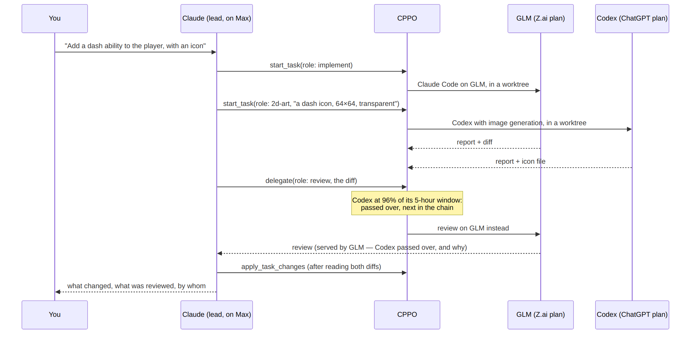

Everything stays visible: the account's hover shows active tasks and links to each one's transcript; the orchestration panel shows what each plan has left and who would serve each role right now.

---

## Architecture

Every VS Code window runs its own extension host, so its environment is its own. This extension activates first and points that window's Claude Code at a private data directory (`CLAUDE_CONFIG_DIR`), which holds the window's account and provider settings. Everything else hangs off that.

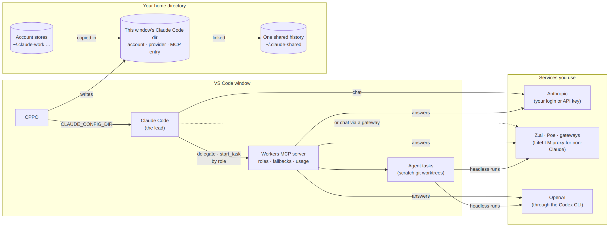

| Part | Source | What it does |
| --- | --- | --- |
| Accounts | `accounts.ts`, `capture.ts`, `setupWizard.ts`, `reclaim.ts` | Discover, save, switch, forget and sign out accounts. |
| Window binding | `binding.ts`, `workdir.ts`, `accountWatcher.ts` | The window's working copy, its environment variable, and noticing sign-ins. |
| Shared history | `sharedHistory.ts` | One history store, linked from every data directory. |
| Status bar | `statusBar.ts` | The account item: its text, click action and hover card. |
| Providers | `providers.ts`, `modelCatalog.ts`, `litellm.ts`, `litellm/` | Per-window billing, gateway model lists, the optional LiteLLM proxy. |
| Workers | `delegate.ts`, `usage.ts` | The MCP server the lead uses: `delegate`, usage, agent task tools. |
| Orchestration | `roles.ts`, `orchestration.ts` | Roles, their fallback chains and effort; the panel that edits them. |
| OpenAI Codex | `codex.ts` | The Codex CLI as a worker: consultations, agent task runs, account, plan usage, models. |
| Agent tasks | `agentTasks.ts`, `transcripts.ts` | Snapshots, worktrees, headless runs, diffs, transcripts. |
| Host state | `hostState.ts` | `~/.claude-windows/.state.json`, shared by every window on the host. |
| Uninstall | `uninstall.js` | Hands back the account and history and removes the extension's folders. |

---

## Requirements

| Requirement | Notes |
| --- | --- |
| Linux environment | desktop Linux, WSL, Remote-SSH (Linux host), or a dev container |
| VS Code ≥ 1.85 | the extension installs into the (remote) Linux side |
| [Claude Code extension](https://marketplace.visualstudio.com/items?itemName=anthropic.claude-code) | the thing being multiplied |
| `claude` CLI on `$PATH` | asked read-only (`claude auth status`) whether a directory is signed in |
| `git` | agent tasks only: they work on a worktree of the window's repository |
| `uv`, or Python 3.10–3.14 | non-Claude models only: installs the local LiteLLM proxy |
| Codex CLI | OpenAI Codex only: the OpenAI extension (`openai.chatgpt`), or `codex` on `$PATH` (`npm install -g @openai/codex`) |

---

## Install

1. **Get the `.vsix`** from the [latest release](https://github.com/warrenb213/cppo/releases/latest) (`cppo-<version>.vsix`), or build it yourself (`npm ci && npm run package`, see [Development](#development--releases)).
2. **Install it** where the extension runs: in the window itself (a WSL or SSH window installs on the remote), *Extensions → ⋯ → Install from VSIX…*, or `code --install-extension cppo-<version>.vsix`. Reload the window.
3. **You're probably already signed in.** The status bar shows your email; the account is saved automatically.
4. **Add another account:** in Claude Code, sign in as it (account menu, or `/login`). The extension saves it and reloads the window onto it; the previous account stays in the list.
5. **Give each window its account:** status bar → *Switch account*. Another window, another account — both run in parallel.

CPPO's extension ID is `warrenb213.cppo`: it has no Marketplace listing, so nothing else can update over it.

### Moving from Claude Parallel Accounts

CPPO replaces Claude Parallel Accounts (`DercasDrol.claude-parallel-accounts` — this project's earlier name, and the original it was built from) under a new ID, `warrenb213.cppo`, so VS Code sees two extensions. Your accounts, providers, roles and history live in `~/.claude-*` and carry over; three things need care:

1. **Update the old extension to 1.15.3 first** (from [CPPO's releases](https://github.com/warrenb213/cppo/releases/tag/v1.15.3)), then install CPPO, then uninstall the old one. Earlier versions of the old extension don't know CPPO, and **their uninstaller deletes the account folders and history CPPO uses**; 1.15.3 steps aside while CPPO is installed and its uninstaller leaves everything in place. If CPPO finds an older copy, it stays idle and says so.
2. **Provider keys:** VS Code keeps secrets per extension, so CPPO can't read the old one's. It recovers the keys a window's settings still hold (gateways such as Z.ai, Anthropic API keys) and asks once for the rest (keys behind the local proxy, OpenAI API keys). Codex on a ChatGPT plan needs nothing: it's Codex's own sign-in.
3. **Each window's provider** is recognised from the window's settings; the workers server is now named `cppo` (tools `mcp__cppo__…`), and the old one's entry is removed from each window's Claude Code config. New Claude Code sessions pick it up.

---

## Accounts

**The status bar item** — `👤 you@example.com` is the account **this window** runs as, confirmed against the real token (`claude auth status`), not just a label. A provider other than Anthropic is named after it (`· Z.ai`), and active agent tasks are counted (`· ⟳ 2`).

- **Click** it for the one action that fits: switching when you have other accounts, picking one when the window is signed out, saving when this is your only account and it isn't saved yet.
- **Hover** it for the full card: the account and plan, the provider, workers and recent agent tasks, actions (*Save*, *Switch account*, *Switch provider*, *Agent tasks*, *Usage*, *Forget…*), and links to the extension page and its log.

**Switching** (*Switch account*) reloads the window; afterwards both the identity Claude Code shows and the token it bills are the ones you picked.

**Signing in as another account inside a window** (Claude Code's account menu, or `/login`) replaces only *that window's* account. The extension saves the new account, keeps the old one, and reloads the window so Claude Code actually switches; other windows are untouched.

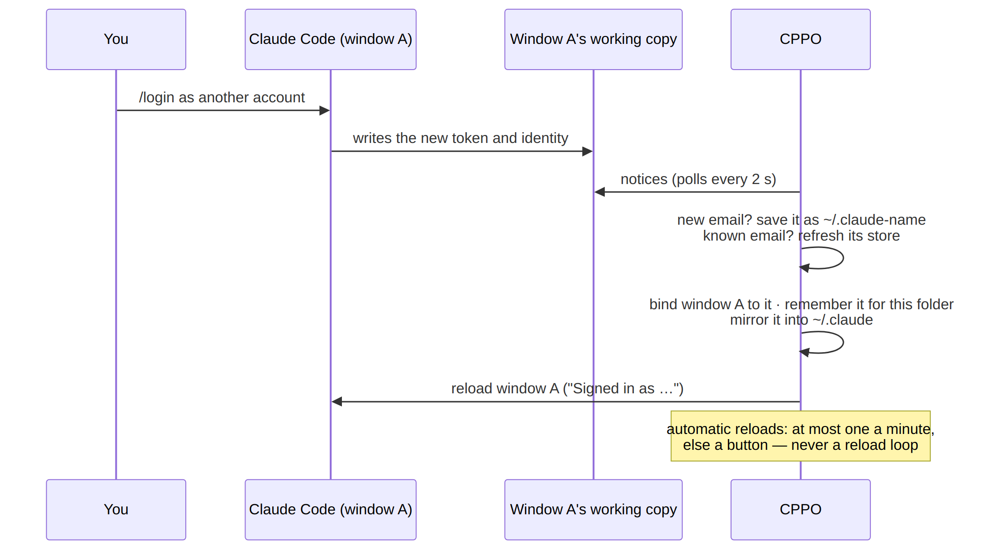

**Reopening a project** restores the account that folder used last (the tooltip says so).

**One account, one entry.** Saving the same email twice reuses the entry; lists show one row per account.

**Forgetting** (hover → *Forget…*) asks first, then:

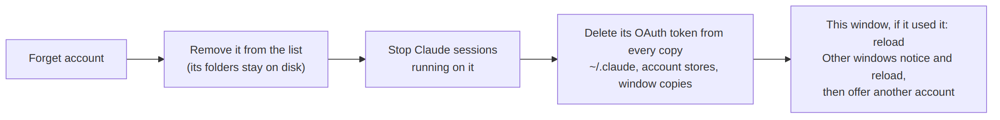

History, settings and the folders stay; signing in again brings the account back.

**Signing out** (Claude Code's account menu, or `/logout`) revokes the token on Anthropic's side. The window shows *Claude: sign in* at once; the next time the window starts, the extension removes the account from the list and deletes the token's other copies, since switching to it could only fail.

---

## One conversation history

Claude Code keeps its history per *data directory*, and plain Claude Code has only one. This extension gives each window a directory of its own, so it puts the history back together in one store, `~/.claude-shared`, linked from every directory:

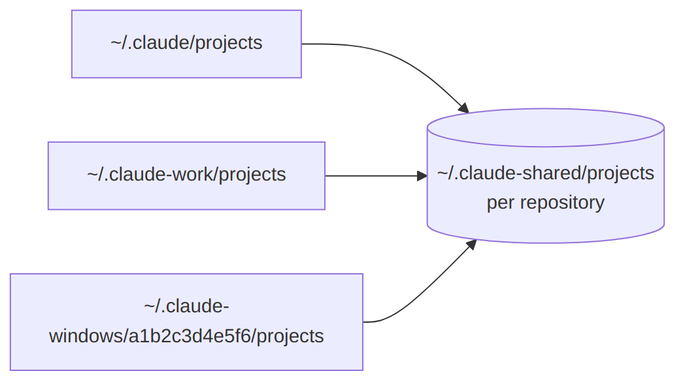

- Linked: `projects`, `sessions`, `session-env`, `shell-snapshots`, `file-history`, `plans`, `todos` and `history.jsonl`. **Credentials and identity never are** — those stay strictly per account.
- Existing history is merged in when a directory is first linked: identical files once, otherwise the newer wins and the older is kept in `~/.claude-shared/.merge-backup`; `history.jsonl` lines are combined.
- Transcripts stay keyed by workspace folder, exactly as Claude Code writes them.

There is nothing to configure: this is what keeps Claude Code's own behaviour intact. Uninstalling moves the store back into `~/.claude`.

---

## Providers

A window's **provider** decides where its requests go and who pays, without changing the account: same history, settings and project trust.

| Kind | What it is | How requests travel |
| --- | --- | --- |
| **Anthropic** (default) | The account's own login: a claude.ai plan (Pro, Max, Team, Enterprise) or a Console key from `/login`. The menu shows which, e.g. *Team plan · Acme*. | Claude Code → Anthropic, as without this extension. |
| **Anthropic API key** | A key from [console.anthropic.com](https://console.anthropic.com), billed per token, without signing the account in with it. | Claude Code → `api.anthropic.com` with that key. The extension pre-approves the key, so Claude Code's "Detected a custom API key" prompt (whose default, *No*, would silently fall back to the login) never appears. |
| **Gateway** | An Anthropic-compatible endpoint with a key. Presets: **Z.ai GLM Coding Plan** and **Poe**; **Custom** for anything else (`Authorization: Bearer` or `x-api-key`). | Claude Code → the gateway. Non-Claude models on gateways that only speak OpenAI's format go through a local LiteLLM proxy. |

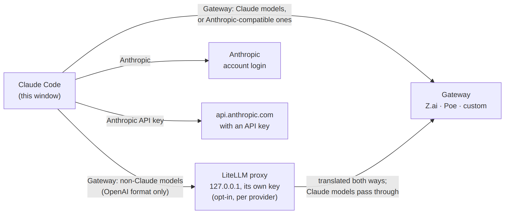

**Switching** (hover → *Switch provider*, or *CPPO: Switch Provider for This Window*) writes the provider's settings into the window's own `settings.json` and reloads the window; terminals follow it. **To go back to Anthropic from anything else, pick *Anthropic*** — the settings the provider took over are restored as they were.

**Adding** (*CPPO: Add a Provider*) lists the presets first, so a preset asks only for a key. A new provider is tested right away with one tiny request, sent the way Claude Code sends it, so a wrong key or an empty balance shows up then rather than mid-chat; it's then offered for this window. *Edit or Remove a Provider* replaces a key, renames or removes a provider, runs the test again, and for gateways changes the URL, the default models, beta headers, non-Claude models and workers.

**Providers belong to one account on one host.** A provider is seen only by windows running that same Claude account on that same host; the same account on another host adds its own.

**OpenAI Codex** is a provider too (*Add a Provider → OpenAI Codex*), first of all for [workers](#openai-codex-as-a-worker). With an **OpenAI API key** it can also run chat windows on GPT: OpenAI isn't Anthropic-compatible, so the local LiteLLM proxy translates, as it does for non-Claude models on gateways (see [GPT in chat windows](#gpt-in-chat-windows-openai-api-key)). On a **ChatGPT plan** it stays workers-only — only Codex itself may use the plan — and isn't offered under *Switch provider*.

### Models on a gateway

- **Z.ai GLM Coding Plan** is set up as [Z.ai documents for Claude Code](https://docs.z.ai/devpack/tool/claude): GLM in the opus/sonnet/haiku slots (`glm-5.3[1m]`, `glm-5.3-flash[1m]`) with its 1M context window and a long request timeout. Change the slots under *Model aliases*.
- **Gateways with a model list** (Poe, most custom ones): `/v1/models` is read when you add it, daily while a window uses it, and on *Refresh model list*. Only the Claude models it serves are kept, and Claude Code's model picker lists exactly those, each recognised as the model it is (thinking, effort levels, context window) and sent under the gateway's name for it (Poe's `claude-opus-4.8` is Anthropic's `claude-opus-4-8`). A model the gateway doesn't serve falls back to an allowed one instead of failing.
- **Auto mode on gateways.** A gateway can't run Anthropic's in-request safety checks, so the extension says so up front (`CLAUDE_CODE_AUTO_MODE_SERVER=0`): auto mode then runs its classifier as separate requests on the gateway, without first holding a request behind an "isn't eligible" notice.

### Non-Claude models (opt-in, per provider)

Many gateways also serve models such as Qwen, GLM or DeepSeek, but only in OpenAI's chat-completions format, which Claude Code doesn't speak. *Edit or Remove a Provider → Non-Claude models* lists the usable ones (text output, tool calling, at least a 200K context window — what Claude Code assumes for a model it doesn't know) and adds the ones you pick to the model picker. The first one asks to install a local [LiteLLM](https://github.com/BerriAI/litellm) proxy (about 600 MB, into `~/.claude-windows/litellm`):

- **Pinned by hash.** LiteLLM's PyPI package was hijacked in March 2026, and this proxy holds your gateway key, so it is never installed by name: every package is pinned by SHA-256 in the extension's lockfile and installed with `--require-hashes`.
- **Local only.** One proxy per provider per host, on `127.0.0.1`, behind a random key of its own. Windows hold only that key; the gateway key lives in the proxy's environment, never in a file. LiteLLM's start-up downloads of remote configuration are off.
- **Fixed for Claude Code.** A small callback rewrites tool schemas gateways reject (`prefixItems`) and holds back a gateway's early `finish_reason`, which otherwise cut off parallel tool calls.
- **Shared and stopped cleanly.** Windows on the same provider share the proxy; a window on an older extension version reuses a newer one's rather than fighting over it. Turning the models off, removing the provider, or uninstalling stops it. *Show proxy log* opens its log.

Claude Code is built for Claude; other models can use its tools, but less reliably.

---

## Workers

The window's Claude (the **lead**) can hand work to other models you've set up — Claude on your subscription leads and asks, say, GLM on Z.ai or GPT through Codex for a second opinion, a review or a whole change. Workers are off until you pick them, per provider (*Edit or Remove a Provider → Workers*), with a one-time confirmation of what leaves the machine. Claude on the account's own login can be a worker too (*Anthropic login (this account)*: haiku, sonnet, opus).

| | `delegate` (answers) | Agent tasks (real work) |
| --- | --- | --- |
| Opt-in | per worker model | a second opt-in per worker model |
| The worker gets | the task and what the lead pastes in | a scratch copy of the repo, file tools and a shell |
| What comes back | an answer | a report and a diff, applied only by the lead |
| The lead's tools | `list_workers`, `delegate`, `provider_usage` | `start_task`, `wait_task`, `cancel_task`, `apply_task_changes` |

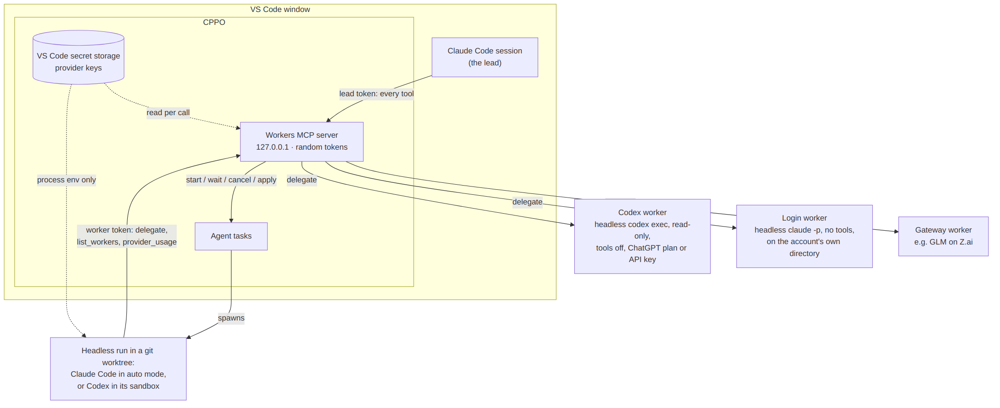

**How it's served.** A small MCP server inside the extension, on `127.0.0.1`, registered in the window's own Claude Code config (`.claude.json`) while some worker is enabled, and removed when none is or the window closes. Open sessions are told when workers change (`tools/list_changed`) and pick up the new tools without restarting. Each call reads the provider's key from VS Code's secret storage; the window's own provider is untouched.

### Orchestration: roles and fallbacks

Instead of picking a model each time, the lead asks for a **role** — `delegate(role: "review")`, `start_task(role: "implement")` — and the extension decides who serves it, the same way every time, from chains you set in *CPPO: Orchestration* (also in the account's hover).

| Category | Role | Tool | For |
| --- | --- | --- | --- |
| Answers | `quick` | `delegate` | summaries, bulk rewriting, quick checks |
| | `second-opinion` | `delegate` | an independent take from another model family than the lead |
| | `review` | `delegate` | code review: bugs, risks, missing tests |
| | `hard-reasoning` | `delegate` | algorithms, architecture, subtle bugs |
| Build | `implement` | `start_task` | a change in a scratch worktree, built and tested |
| | `test-and-fix` | `start_task` | run the tests, fix what fails |
| Art | `2d-art` | `start_task` | raster images (sprites, textures, concept art) from Codex's image generation, saved as files |
| | `vector-art` | `start_task` | SVG icons, diagrams, simple vector art |

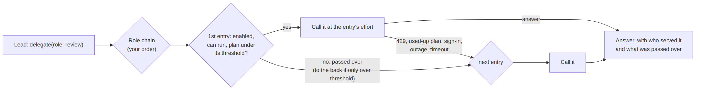

- **Chains.** Each role has an ordered list of worker models, each with an **effort** (low → max: Claude Code's `--effort`, Codex's reasoning effort within what the model takes, a thinking budget on Messages-API workers). Until you save your own, a **template** builds them from your workers, subscriptions first — e.g. implement on GLM's Coding Plan, review and second opinions on Codex, hard reasoning on Opus on your login, 2D art on Codex.
- **Thresholds.** An entry whose plan has used more than 95% of a 5-hour window or 90% of a weekly one (yours to change) is passed over to the back of the chain; when every entry is past its threshold, the least-used still serves. Usage comes from Codex and Z.ai (read when older than five minutes) and, for the Anthropic login, from the usage report Claude Code itself caches as you work (what `/usage` shows) — read from the file, never fetched with your token.
- **Fallback.** A consultation that fails for a reason the next provider may not share — rate limit, used-up plan or balance, sign-in, outage, timeout — moves to the next entry; a malformed request doesn't. An agent task starts on the first entry that can run now (it isn't restarted mid-run).
- **Visible.** Each answer and task says who served it and what was passed over and why; transcripts record the role and effort. `list_roles` gives the lead the same picture.
- **The panel** shows every model your providers offer — enabled or not — with what each can do (*answers*, *agent tasks*, *images*, *sees images*) and its plan's usage with reset times; each role's chain to reorder, extend or switch off; the thresholds; and, live as you edit, who would serve each role. A role's *Add* list holds every model that can do that kind of work; one that isn't enabled yet is marked *enabled on save*, and saving enables what the roles use (as a worker, and for agent tasks where the role needs them) after one confirmation. *Suggest from all models* builds chains from everything available, strongest current model first and the first fallback on another provider.
- **Where capabilities come from.** Codex says which models it offers, which take images, and whether the account can generate them (`model/list`, `modelProvider/capabilities/read`); a gateway's model list says what it serves to Claude Code; agent tasks need a provider key or Codex, so models on the Anthropic login answer only.
- The window's own chat can't switch providers mid-conversation (that takes a reload); roles cover the work the lead hands off.
- **Chains are for different services.** They balance work across the services you use — your Anthropic plan, Z.ai, Codex. Chaining several accounts or keys of one service to stretch its limits may break that service's terms; see [Terms of service](#terms-of-service).

### `delegate`: answers only

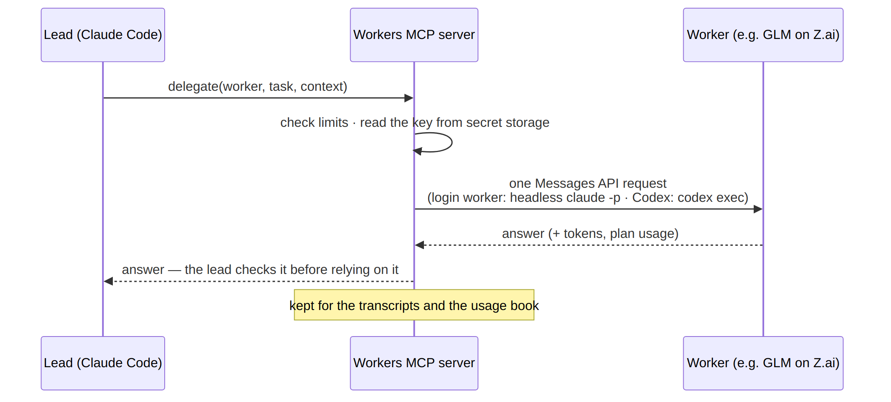

- The worker gets the task and what the lead pastes in — nothing else. It can't read files, run commands or change anything.
- At most 120,000 characters sent and 8,192 tokens back per call, and 100 calls per window session. GLM gets extra room for its thinking, and is asked again without thinking if that used the whole budget.
- **Login workers** run Claude Code itself, headless, on the account's own directory (never a window's working copy, which may be set to a gateway), with no tools, no MCP servers and the session not saved. The extension never handles the subscription's token. Calls count toward the plan.
- **Codex workers** run Codex itself — see [OpenAI Codex as a worker](#openai-codex-as-a-worker).

### Agent tasks: real work, reviewed by the lead

A worker enabled for agent tasks runs **Claude Code headless on its own model** (e.g. GLM-5.3 on Z.ai), in **auto mode** — or, for a Codex worker, **Codex itself** in its sandbox — inside a scratch **git worktree** of your repo. It edits files and runs builds and tests there; nothing reaches your working tree unless the lead reviews the diff and applies it.

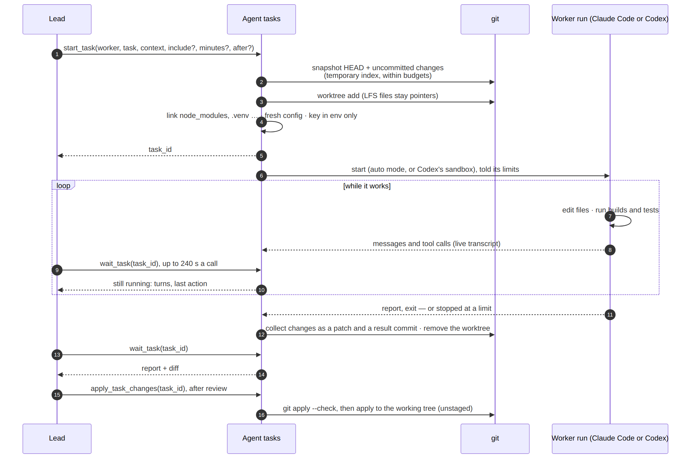

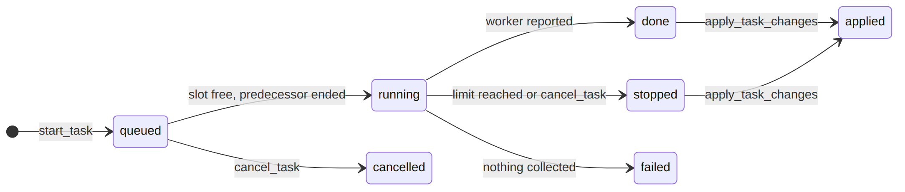

*Stopped* shows as `failed` or `cancelled` with its changes kept. A done or stopped task can also be continued: `start_task(after: id)` queues a new task that starts from its changes.

- **The snapshot.** HEAD plus your uncommitted changes, built with a temporary index so yours is never touched. Untracked files come along within a budget — 5 MB a file, 100 MB and 2,000 files in all, `.gitignore` respected — by top-level folder, smallest first; a folder that doesn't fit is left out whole. Git LFS files are never copied (they stay pointers). A repository whose tracked files exceed 5 GB is refused. What was left out is told to the worker and the lead.
- **Gitignored files it needs.** The lead lists them in `include` (files or folders; 5 MB a file, 100 MB and 2,000 files in all), or names a file in the task by absolute path. Paths to your repo in the task are rewritten to the worker's copy.
- **Builds and tests.** Gitignored dependency folders at the top of the repo (`node_modules`, `.venv`, `venv`, `vendor`, …) are linked into the worktree. They're your copies, so the worker is told not to install into them, and the links are removed before its changes are collected.
- **Isolation.** A fresh Claude Code config: none of your login, plugins or MCP servers; the provider key only in the run's environment. (Codex runs: see [below](#openai-codex-as-a-worker).) It runs the Claude Code extension's own binary — the version your chats use — and `claude` on PATH only where that extension isn't installed. A run that doesn't start in auto mode (an older Claude Code may quietly fall back to "default", where every edit is denied) is stopped at once with that reason.
- **Safety checks.** Auto mode checks each consequential action with a classifier on the worker's own model (about 35K tokens a check on Z.ai).
- **What comes back.** The report and a diff against the snapshot: changes to existing files, and new files the worker wrote with its file tools. Files that only appeared as side effects of its commands (build output, caches, logs) are listed but left out. The patch and run log stay under `~/.claude-windows/agent-tasks` for 7 days.
- **Applying.** `apply_task_changes` checks the patch first and applies it to the working tree only — never staged — with your usual Claude Code permission for that tool.
- **Limits.** 2 tasks at a time. Each gets 2 hours and 300 turns unless the lead sets `minutes` (5–480) or `max_turns` (10–1000); a run with no output for 20 minutes is taken as stuck. The worker is told its limits so it can stop in time to report.
- **Stopped runs keep their work.** A run stopped at a limit or cancelled keeps the changes it made: the lead can apply them, or continue with `start_task(after: id)` — the follow-up starts from them and is told where the run stopped, with its last message.
- **Chains.** `after` also builds pipelines: a task starts from another's result (waiting for it if it's still running), so fix → test → docs can be queued at once. Applying the last task of a chain applies the earlier, not yet applied ones too; nothing lands half-done.
- **Workers can consult.** A run can call `delegate` itself — GLM asking Claude on your subscription for a second opinion mid-task, say — plus `list_workers` and `provider_usage`. It can't start tasks: runs reach the workers server with a token limited to those three tools.

### Seeing what workers did

The account's hover card lists the workers and the recent tasks: worker, progress and current action while running; files changed and whether applied when done; why it stopped.

- **Transcripts.** A task's worker name in the hover opens that task's transcript; a worker under *Workers* (with a count) lists its tasks and consultations in this window. Transcripts open in the Markdown preview. A task's shows its run — messages, each tool call with its command or edit, results and thinking collapsed, the report and changes — and follows along while it runs; a consultation's shows the question, context and answer. Also *CPPO: Show Worker Transcripts*. Consultations are kept in memory only, the latest 50.
- **Usage.** `provider_usage` (for the lead and for runs) and *CPPO: Show Provider Usage* report how much of each plan is used, so work can be balanced across the different services you use: the Anthropic login's 5-hour, weekly and per-model weekly windows (from the usage report Claude Code caches in this account's windows — just a file read — and its rate-limit reports on login-worker calls), the ChatGPT plan's Codex windows (from Codex itself, without sending a message), Z.ai's Coding Plan windows (from its quota monitor — unofficial, may change), and this window's calls, tasks and tokens per worker.

### OpenAI Codex as a worker

*Add a Provider → OpenAI Codex* adds GPT models (e.g. `gpt-6.1-sol`, `gpt-6-astra`, `gpt-6-luna` — whatever Codex lists for your account) as workers. Everything runs through the **Codex CLI itself**: the OpenAI extension's bundled `codex`, or `codex` on PATH.

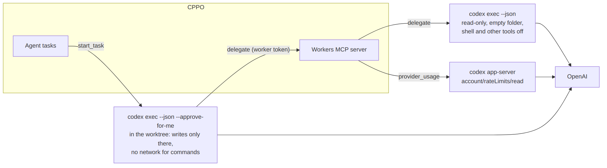

- **Signing in.** *ChatGPT plan* (the default) uses Codex's own sign-in on this host (`~/.codex`); the extension never reads or sends its tokens. If Codex isn't signed in, adding the provider offers *Sign in to Codex*, which opens a terminal running `codex login` (`--device-auth` in a remote window, where the browser is on another machine). *OpenAI API key* is billed per token: the key stays in VS Code's secret storage and reaches each run as `CODEX_API_KEY`, with a Codex home of its own (`~/.claude-windows/codex/<id>`), so it never touches your own Codex sign-in or config.
- **Consultations** run `codex exec` read-only, in an empty temporary folder, with the shell and other tools off and your Codex config and rules not loaded — the task and the lead's material, nothing else.
- **Agent tasks** run Codex in the worktree with `--approve-for-me`: its workspace-write sandbox (writes only inside the worktree; linked dependency folders can be read but not written; commands get no network), approval requests reviewed automatically, browser, desktop and plugins off, nothing kept on disk (`--ephemeral`). It can consult other workers through the workers MCP server with the restricted token. Its transcript shows each shell command, edit and consultation. Limits count Codex *steps* (each message, command or edit).
- **Usage.** On a ChatGPT plan, `provider_usage` shows the plan's Codex windows (5-hour and weekly, and any per-model limits) from Codex's own report, read without sending a message. On an API key, tokens only.
- **Test connection** asks Codex who it's signed in as (ChatGPT plan), or checks the key against OpenAI's model list (API key). *Refresh model list* re-reads what Codex offers.

#### GPT in chat windows (OpenAI API key)

An API-key Codex provider can also bill a whole chat window: *Edit or Remove a Provider → Codex → Chat-window models* (or *Set up chat windows* when adding it, or picking it under *Switch provider*) chooses which GPT models appear in Claude Code's model picker and which one is the default.

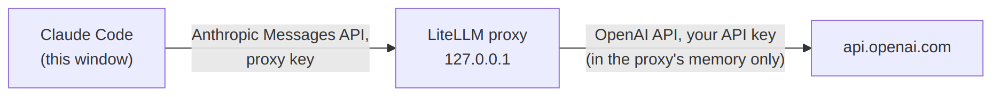

- Claude Code's model slots get GPT models — sonnet (its default) your pick, opus and haiku the closest enabled match (e.g. `gpt-6-astra`, `gpt-6-luna`); haiku also runs Claude Code's titles and summaries. Only the enabled models are allowed, so a Claude model saved earlier falls back to one of them.
- Same proxy as for non-Claude gateway models: hash-pinned LiteLLM, `127.0.0.1` only, the key in its memory, stopped when the models are turned off or the provider removed.
- **Billed per token to the API key** — an OpenAI Platform key is separate from a ChatGPT plan, which includes Codex but not API usage. Codex workers on a ChatGPT plan keep counting toward the plan.
- Claude Code is built for Claude; GPT uses its tools, but less reliably.
- Not for a ChatGPT plan: tools that do this (LiteLLM's `chatgpt/` provider among them) sign in with the Codex CLI's own OAuth client and present themselves as Codex to ChatGPT's private backend. This extension doesn't — the plan is only ever used by Codex itself.

---

## Commands

All under **CPPO** in the Command Palette; most are also in the status bar hover.

| Command | What it does |
| --- | --- |
| Switch Account for This Window | Pick a saved account; reloads the window. |
| Save Current Account | Save the account this window is signed in as (usually automatic). |
| Account Quick Action | The status bar click. |
| Forget a Saved Account | Remove an account and delete its token everywhere on this host. |
| Switch Provider for This Window | Anthropic, an API key, or a gateway; reloads the window. |
| Add a Provider | Presets (Z.ai, Poe), OpenAI Codex (workers), an Anthropic API key, or a custom gateway. |
| Edit or Remove a Provider | Key, URL, models, connection test, non-Claude models, workers. |
| Show Agent Tasks | Open a task's transcript, log or patch, or cancel it. |
| Show Worker Transcripts | A worker's tasks and consultations in this window. |
| Show Provider Usage | How much of each plan is used. |
| Orchestration (Roles and Fallbacks) | Roles by category, their chains, effort and thresholds, and who serves each now. |
| Show Log | What the extension has been doing. |

**Settings: none.** Everything is managed from the status bar and these commands.

---

## Privacy & your data

This extension manages credentials, so it holds itself to a strict policy — each point verifiable in the source.

- **No telemetry, no analytics, no runtime dependencies** — your files, the `vscode` API and Node's standard library.
- **Network requests, all to services you set up:**
  - a gateway's model list (`GET /v1/models`), when added, daily while in use, and on *Refresh*;
  - a provider's connection test: one tiny request when it's added and on *Test connection*;
  - worker calls (`delegate`), to the worker's provider, with what the lead sends;
  - Z.ai's quota monitor, for usage reports (a plain GET with the Z.ai key);
  - with non-Claude models on, the hash-pinned LiteLLM install from PyPI, and the proxy's traffic to your gateway;
  - Claude Code runs it starts (login workers, agent tasks) talk to their provider like any Claude Code session;
  - Codex runs it starts (Codex workers and their agent tasks, usage and model lookups through `codex app-server`) talk to OpenAI like any Codex session, and an OpenAI API key's connection test reads `api.openai.com/v1/models`.

  With no providers or workers added, it makes no requests at all.
- **Everything stays in your home directory.** Accounts, working copies, the history store and host state live under `~/.claude*`, created owner-only (`700`/`600`). Credentials are only ever *copied between* Claude Code's own data directories on this host — never parsed beyond checking they exist, never displayed, never sent anywhere.
- **Provider keys** are kept in VS Code's secret storage on the computer running VS Code, under a name tied to the account and host. A window using a provider also gets a copy in its own `settings.json` (`600`), because that file is how Claude Code receives it; switching back to Anthropic, removing the provider, or uninstalling removes it. With non-Claude models on, the window gets the local proxy's key instead.
- **Workers send what the lead chooses, to the provider you enabled** — and, for a gateway such as Z.ai, to the model's maker — billed to its key or counted toward its plan (a ChatGPT plan, for Codex). Nothing is sent unless the AI calls the tool, and only to models you switched on.
- **Agent tasks read your repo.** A worker enabled for agent tasks reads a scratch copy of the repository as it works, so that content goes to its provider. Its run has no access to your login, plugins or MCP servers, and its changes stay in the copy unless the lead applies them.
- **History is moved, not read.** It is relinked, never parsed or sent; when two directories hold the same file it's compared byte for byte, and `history.jsonl` lines are merged.
- **Host state** (`~/.claude-windows/.state.json`) records your accounts, providers (without keys), and which account each folder used last — by the folder's path. Window working copies are named by a hash of the workspace path.
- **Elsewhere:** `claude auth status` is asked locally, read-only; the process list is scanned only during *Forget*, to stop `claude` processes on the token being deleted.
- **Restricted by its manifest:** disabled in virtual workspaces, and in Restricted Mode (untrusted folders) it never reads workspace content ([`capabilities`](package.json)).
- **Inert off Linux** — no operations at all; the uninstall hook is guarded the same way.

---

## Terms of service

Every account, key and plan you connect is governed by its provider's terms — Anthropic's, OpenAI's, Z.ai's, Poe's, your gateway's — and **you are responsible for following them**. This extension doesn't check, enforce or work around anyone's terms, and nothing in it is meant as a way to get around a provider's usage limits.

- **Several accounts with one service.** Many providers don't allow using more than one account or key to get around usage limits. Separate accounts for separate purposes — personal and work, or different organizations — are the reason this extension supports several. When you save a second Claude account, or add a provider of a service this host already has (a second Z.ai key, a second Codex sign-in, a second Anthropic API key…), the extension says so and points to that service's terms.
- **Subscriptions are used only by their own clients.** A Claude plan is only ever used by Claude Code, a ChatGPT plan only by Codex; the extension never reads, copies or sends their tokens, and doesn't route them through anything else (see [GPT in chat windows](#gpt-in-chat-windows-openai-api-key) for why a ChatGPT plan can't serve a chat window here).
- **What you send to a worker** goes to that provider under its terms and data policies.

---

## Uninstalling

Removing the extension leaves Claude Code **signed in and working**, with your whole history.

**You stay signed in the whole time, not just at the end.** While the extension runs, it keeps Claude Code's default `~/.claude` signed in as the account you last used. So the instant the extension is gone — uninstalled, disabled, or not activated yet — plain Claude Code works. Nothing that matters waits on the uninstall script, which VS Code defers to its next restart and may skip.

When the uninstall script runs, it has a 4-second deadline (VS Code kills it at 5):

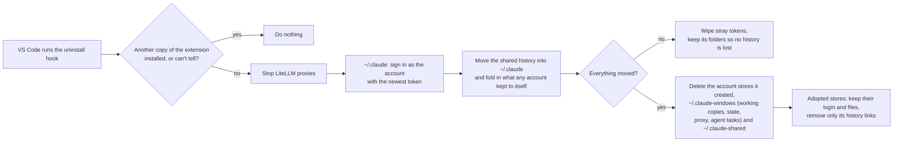

- Moving the history is a rename — instant, whatever its size.
- Your other accounts are signed out afterwards: plain Claude Code holds one account at a time.
- **Which account stores are deleted:** only the ones the extension created (they carry a `.claude-parallel-accounts` marker). A signed-in `~/.claude-<name>` folder that was already there when the extension found it is adopted as an account but stays yours: uninstall keeps it with its login and files, and only removes the history links it added — that history is in `~/.claude` now. (Stores saved before 1.14.2 were sorted once on upgrade: one named after its account's email, the way the extension names them, counts as created.)

---

## Limitations

- **Linux only for now.** macOS keeps credentials in the Keychain and native Windows is untested; on both the extension refuses to run rather than guess.
- **Loads at every VS Code start-up** (`*` activation) — required to win the race against Claude Code (see [How it works](#how-it-works)). The bundle is about 130 KB with no dependencies.
- **Switching reloads the window**, account or provider: Claude Code reads both once at start-up.
- **The same project in two windows shares one conversation list.** A folder and a `.code-workspace` containing it are two windows on one project; both see the same chats and could resume the same one under different accounts. The transcript is a tree, so this forks the conversation rather than corrupting it — but the two branches bill two accounts. Don't drive one chat from two windows at once.
- **Sign-out is tidied up at the next start.** After `/logout` the window shows *Claude: sign in* at once, but the account leaves the list when the window next starts.
- **Agent tasks need a git repository** with at least one commit, and `git` on the host.
- **Other models in Claude Code** use its tools less reliably than Claude, and auto mode's safety checks run on them too.
- **Unofficial usage data.** Z.ai's quota monitor isn't a documented API; the Anthropic plan's usage is as fresh as Claude Code's last fetch of it (its age is shown).
- **New in 1.15 and not yet run end to end:** Codex consultations and agent tasks, 2D art through Codex's image generation in a headless run, and GPT chat windows on an OpenAI API key. Their parts are tested up to the provider (sign-in, usage, models, capabilities, the proxy's route to OpenAI); a first real run may still turn up an issue.

---

## How it works

Claude Code resolves its data directory from the `CLAUDE_CONFIG_DIR` environment variable, and every VS Code window runs its own extension host, so `process.env` is per window — that's the isolation. Each **account** is a store (`~/.claude-<name>`); each **window** runs on a private working copy of the account it picked.

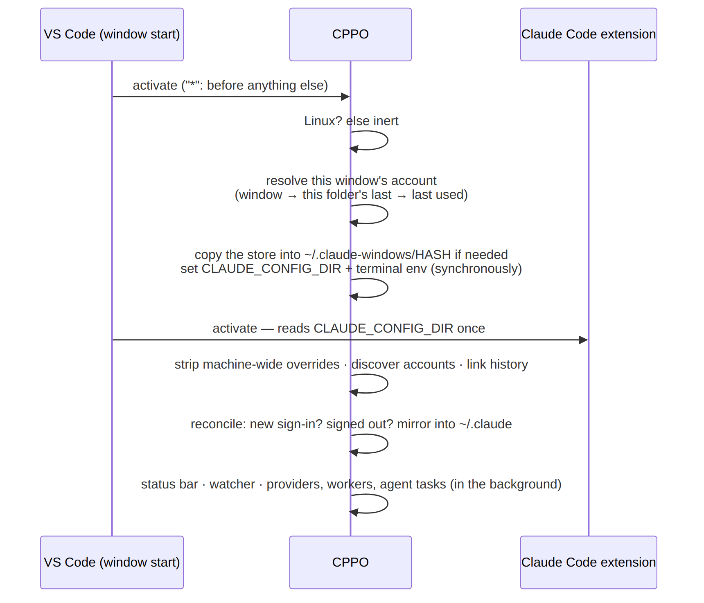

The details that make it reliable — each one a bug found and fixed:

- **Activation order.** Claude Code reads `CLAUDE_CONFIG_DIR` the moment it activates and caches it, so this extension must get there first. It uses the `*` activation event, which VS Code's docs discourage because it loads at every start-up: a deliberate trade-off, since with any lazier activation the variable would be set after Claude Code read it. The variable is set synchronously before anything else; account discovery and history linking follow, and providers and workers start in the background.
- **A working copy per window** (`~/.claude-windows/<12 hex>`, from a hash of the workspace). A `/login` writes into the window's own copy, so it can only affect that window — "which window signed in?" is answered by construction.
- **No competing source of truth.** A machine-wide `CLAUDE_CONFIG_DIR` in `claudeCode.environmentVariables` or `terminal.integrated.env` would force every window onto one account; the extension removes it and keeps isolation in `process.env` only.
- **Terminals follow the window** through VS Code's environment-variable API. External terminals keep the default `~/.claude`.
- **Provider settings live in the working copy.** A provider is written into the window's own `settings.json` (environment and model settings Claude Code reads at start), and only the keys the extension manages; everything else in that file is left alone. Workers are registered in the window's own `.claude.json`.
- **Host-wide state, per-host keys.** Accounts, providers and folder memories are in `~/.claude-windows/.state.json`, shared by every window on the host; VS Code's own storage is shared across hosts by the client, so only secrets live there, under host-specific names.
- **Reload safety.** Automatic reloads go through a circuit breaker: state is corrected *before* reloading, and at most one automatic reload a minute — an edge case degrades to a message with a button, never a reload loop.
- **Survives its own absence.** The account you last used is mirrored into `~/.claude` on every sync, so Claude Code works the instant the extension is gone.
- **Found where it runs.** One universal package, not per-platform: in WSL and Remote-SSH it runs on the Linux remote, but the client that resolves extensions is often Windows or macOS. The Linux requirement is enforced at runtime instead (the inert mode above).

---

## Development & releases

```bash
npm ci            # install
npm run watch     # dev build with watch
npm run compile   # typecheck + build
npm run package   # build the .vsix (production bundle)
scripts/render-diagrams.sh   # README diagrams: docs/diagrams/*.mmd → .png
```

The README's diagrams are PNGs rendered from the Mermaid sources in `docs/diagrams/` — VS Code's extension page doesn't render Mermaid, and the packager refuses SVG images. Edit the `.mmd`, then run the script.

**Releases** are [GitHub Releases](https://github.com/warrenb213/cppo/releases): a `v<version>` tag with `cppo-<version>.vsix` (built by `npm run package`) attached, and the version's `CHANGELOG.md` entry as its notes. They're made by hand — `gh release create v<version> cppo-<version>.vsix --notes-file …` — and installed by hand ([Install](#install)). CPPO is **never published to the Marketplace or Open VSX**: GitHub Actions are disabled on the repository, and the publish steps in the workflow files inherited from the original project ([`ci.yml`](.github/workflows/ci.yml), [`release.yml`](.github/workflows/release.yml)) only run in that project's repository.

---

## Support CPPO

CPPO is free and open source. If it saves you time, you can support its development through [PayPal](https://paypal.me/beboutit503) — or scan the code at the top of this page. Thank you.

---

## License

MIT License — see [LICENSE](LICENSE). CPPO is based on [Claude Parallel Accounts](https://github.com/DercasDrol/claude-parallel-profiles) by DercasDrol, whose per-window accounts and shared history it builds on; providers, workers, agent tasks and orchestration are CPPO's.
